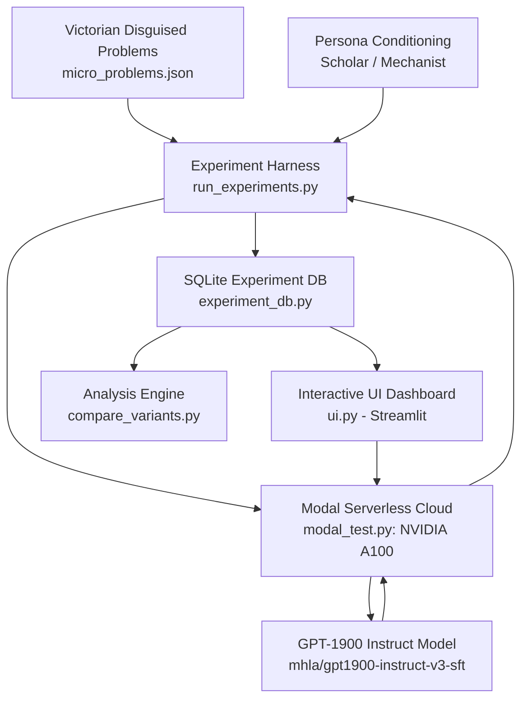

# Anarchist LLM (GPT-1900 Research & Experimentation Suite)

<p align="center">
  
</p>

<p align="center">
  <em>Investigating algorithmic emergence and reasoning frontiers in pre-1900 trained language models through disguised Victorian computational problems.</em>
</p>

<p align="center">
  <a href="https://huggingface.co/collections/mhla/gpt-1900"></a>
  <a href="https://github.com/AadilUsmani/Anarchist-LLM"></a>
  <a href="LICENSE"></a>
  <a href="https://modal.com"></a>
  <a href="https://docs.astral.sh/uv/"></a>
</p>

---

## 📖 Table of Contents

- [Overview](#-overview)
- [Research Hypothesis & Goals](#-research-hypothesis--goals)
- [Project Architecture](#-project-architecture)
- [Key Components](#-key-components)
  - [1. Disguised Micro-Problems Benchmark (`micro_problems.json`)](#1-disguised-micro-problems-benchmark-micro_problemsjson)
  - [2. Batch Experiment Framework (`run_experiments.py`)](#2-batch-experiment-framework-run_experimentspy)
  - [3. Experiment Tracking & Metrics DB (`experiment_db.py`)](#3-experiment-tracking--metrics-db-experiment_dbpy)
  - [4. Algorithmic Drift & Variance Analysis (`compare_variants.py`)](#4-algorithmic-drift--variance-analysis-compare_variantspy)
  - [5. Interactive Streamlit Research UI (`ui.py`)](#5-interactive-streamlit-research-ui-uipy)
  - [6. Cloud GPU Inference with Modal (`modal_test.py`)](#6-cloud-gpu-inference-with-modal-modal_testpy)
  - [7. Core GPT-1900 Transformer Engine (`nanochat/`)](#7-core-gpt-1900-transformer-engine-nanochat)
- [Repository Structure](#-repository-structure)
- [Installation & Quickstart](#-installation--quickstart)
  - [Environment Setup](#environment-setup)
  - [Deploying Modal Inference Function](#deploying-modal-inference-function)
  - [Launching the Streamlit UI](#launching-the-streamlit-ui)
  - [Running Algorithmic Batch Experiments](#running-algorithmic-batch-experiments)
  - [Analyzing Drift & Results](#analyzing-drift--results)
- [Evaluation Datasets](#-evaluation-datasets)
- [Personas & Prompt Engineering](#-personas--prompt-engineering)
- [License & Citations](#-license--citations)

---

## 🏛 Overview

**Anarchist LLM** is an empirical research suite exploring the conceptual and algorithmic capabilities of **GPT-1900**—a family of autoregressive language models trained from scratch solely on human text published prior to the year 1900.

The fundamental inquiry of this project is:
> *Can an artificial intelligence devoid of post-1900 knowledge "invent" or discover modern Computer Science algorithms (e.g., Dijkstra's Shortest Path, Merge Sort, Binary Search, Hash Tables, Dynamic Programming, PageRank) when presented with problems disguised in 19th-century Victorian industrial, administrative, and scientific contexts?*

By stripping away modern terminology ("graph", "node", "time complexity", "O(N log N)", "pointer", "array") and re-encoding problems as Victorian ledger sorting, railway line inspection, telegraph routing, or parish census management, this codebase isolates raw reasoning ability from memorized computer science curriculum.

---

## 🔬 Research Hypothesis & Goals

1. **Pre-Formal Algorithmic Discovery**: Test whether divide-and-conquer, greedy heuristics, dynamic programming memoization, and spatial indexing naturally emerge when an intelligent agent is forced to optimize large-scale Victorian logistical constraints.
2. **Persona & Epistemic Framing**: Quantify how different historical personas (e.g., *Victorian Consulting Scholar*, *Hollerith Tabulating Machinery Operator*, *Royal Railway Engineer*) alter the efficiency, drift, and structural rigor of generated solutions.
3. **Algorithmic Drift Quantification**: Track deviations where the model digresses into cost estimation, labour politics, physical construction constraints, or anachronistic hallucinations instead of procedural algorithms.

---

## 🛠 Project Architecture



---

## 🧩 Key Components

### 1. Disguised Micro-Problems Benchmark (`micro_problems.json`)
A curated dataset of modern algorithmic problems translated into rich, historically authentic 19th-century scenarios:

| Target Algorithm | Optimal Complexity | Paradigm | Victorian Domain Disguise |
| :--- | :---: | :---: | :--- |
| **Merge Sort** | $\mathcal{O}(n \log n)$ | Divide & Conquer | Census Parish Ledgers, British Museum Acquisitions |
| **Bubble Sort** | $\mathcal{O}(n^2)$ | Exhaustive Comparison | Coin Denomination Sorting, School Exam Results |
| **Dijkstra's Algorithm** | $\mathcal{O}(E \log V)$ | Greedy Shortest Path | Great Western Railway Telegraph Network, Mail Coach Routing |
| **Breadth-First Search** | $\mathcal{O}(V + E)$ | Level-Order Traversal | Broad Street Cholera Outbreak Pipe Exposure Mapping |
| **Binary Search** | $\mathcal{O}(\log n)$ | Bisection Search | Lloyd's Maritime Registry Ship Lookups |
| **Hash Tables** | $\mathcal{O}(1)$ | Direct Addressing / Bucketing | London Trade Directory Pigeonhole System |
| **Dynamic Programming** | $\mathcal{O}(nW)$ | Overlapping Subproblems | Royal Mint Coinage Optimization, Naval Cargo Stowing |
| **PageRank** | $\mathcal{O}(V + E)$ | Iterative Eigenvector Centrality | Victorian Scientific Citation & Academic Authority Indexing |

---

### 2. Batch Experiment Framework (`run_experiments.py`)
A robust experiment orchestration pipeline designed to test multiple algorithms, personas, seeds, and sampling temperatures over remote GPUs:

- **Modal Function Integration**: Dispatches single-turn inferences to cloud instances with zero local GPU requirements.
- **Resume & Fault Tolerance**: Resumes partial batch runs without re-executing already logged trials.
- **Dry-Run Mode**: Inspects the entire matrix of prompts, seeds, and personas before submitting jobs.

---

### 3. Experiment Tracking & Metrics DB (`experiment_db.py`)
A structured SQLite database interface that stores every trial with comprehensive metadata:

- Prompt inputs, system prompts, seed, model checkpoint identifier.
- Response content, completion timestamp, latency/duration.
- Heuristic scoring, drift indicators, and algorithmic pattern tags.
- Export capabilities to structured JSON and analysis bundles.

---

### 4. Algorithmic Drift & Variance Analysis (`compare_variants.py`)
Heuristic evaluation engine that detects whether the model remained focused on algorithmic steps or drifted into Victorian tangents:

- **Drift Indicators**: Monitors overemphasis on financial costs (pounds sterling), labor management, physical track laying, or impossible historical hedging.
- **Procedural Keywords**: Quantifies presence of sorting passes, priority queues, shortest-distance relaxation, bucket partitioning, and recursive division.
- **Comparative Scoring**: Ranks variants by coherence, algorithmic density, and drift resilience.

---

### 5. Interactive Streamlit Research UI (`ui.py`)
A full-featured web dashboard providing:

- **Live Chat Interface**: Interactive chat with GPT-1900 running on remote A100 GPUs.
- **Persistent Chat History**: Session storage via SQLite (`db.py`) with title renaming, markdown export, and deletion.
- **Experiment Inspector**: Visual breakdown of benchmark results, response drift scores, and procedural accuracy across runs.

---

### 6. Cloud GPU Inference with Modal (`modal_test.py`)
A serverless inference worker using [Modal](https://modal.com):

- Runs on **NVIDIA A100 / A10G** hardware with optimized PyTorch CUDA memory management (`PYTORCH_CUDA_ALLOC_CONF=expandable_segments:True`).
- Automatically downloads and mounts weights for `mhla/gpt1900-instruct-v3-sft` into persistent Modal network volumes.
- Low cold-start overhead and rapid generation turnaround.

---

### 7. Core GPT-1900 Transformer Engine (`nanochat/`)
The native PyTorch transformer implementation underpinning GPT-1900:

- **FlashAttention-3** acceleration and rotary position embeddings.
- Custom BPE Tokenizer (`HuggingFaceTokenizer` / `rustbpe`).
- High-efficiency KV Cache and streaming engine.
- Distributed data loaders and evaluation benchmarks (`loss_eval.py`, `core_eval.py`).

---

## 📁 Repository Structure

```
Anarchist-LLM/
├── micro_problems.json         # Benchmark dataset of Victorian-disguised CS problems
├── run_experiments.py          # Batch experiment orchestrator (Modal + SQLite)
├── experiment_db.py            # Experiment SQLite schema, logging, and metrics
├── compare_variants.py         # Algorithmic drift detection and scoring engine
├── test_dijkstra_variants.py   # Specialized Dijkstra persona & variant tester
├── modal_test.py               # Serverless Modal A100/A10G GPU inference worker
├── ui.py                       # Streamlit web application & research dashboard
├── db.py                       # SQLite database interface for chat history
├── view_results.py             # Quick inspection utility for experiment batches
├── see_result_initial.py       # Terminal viewer for initial model generations
├── pyproject.toml              # Project dependencies and packaging metadata
├── .gitignore                  # Git exclusion rules (secrets, venv, large models)
├── LICENSE                     # MIT License
├── EVAL.json                   # Standard physics & scientific evaluation suite
├── EVAL_no_assumptions.json    # Physics evaluation suite without classical cues
├── CHECKPOINTS.md              # Documentation of available model checkpoints
├── SERVER_SETUP.md             # Guide for provisioning cloud GPU servers
├── PROJECT_LOG.md              # Historical development and training experiment log
│
├── nanochat/                   # GPT-1900 core transformer architecture
│   ├── engine.py               # Inference execution and KV Cache engine
│   ├── dataloader.py           # Distributed tokenizing dataloaders
│   ├── tokenizer.py            # BPE tokenizer integration
│   ├── flash_attention.py      # FlashAttention-3 & fallback attention
│   ├── checkpoint_manager.py   # Checkpoint loading and weight management
│   └── common.py               # Hardware autodetection & utility helpers
│
├── scripts/                    # Training, chat, tokenization, and eval CLI scripts
│   ├── chat_cli.py             # Terminal chat client
│   ├── generate.py             # Text generation script
│   ├── base_eval.py            # Physics evaluation harness
│   └── base_train.py           # Pretraining / SFT script
│
├── deploy/                     # Deployment configurations and assets
├── figures/                    # Visualizations, banner art, and analytical plots
├── results/                    # Historical benchmark evaluations and judged outputs
├── runs/                       # Shell scripts for launching chat and training
├── tasks/                      # Custom downstream evaluation tasks
└── tests/                      # Automated test suite
```

---

## 🚀 Installation & Quickstart

### Environment Setup

1. **Clone the repository**:
   ```bash
   git clone https://github.com/AadilUsmani/Anarchist-LLM.git
   cd Anarchist-LLM
   ```

2. **Install dependencies with `uv` (recommended)**:
   ```bash
   # Install uv if you don't have it
   curl -LsSf https://astral.sh/uv/install.sh | sh

   # Create virtual environment and sync dependencies
   uv venv
   source .venv/bin/activate  # On Windows: .venv\Scripts\activate
   uv sync --extra gpu        # Use --extra cpu if running locally on CPU
   ```

3. **Install additional tools**:
   ```bash
   pip install streamlit modal
   ```

---

### Deploying Modal Inference Function

Before running the UI or batch experiments, deploy the Modal worker:

```bash
# Authenticate with Modal (one-time setup)
modal setup

# Deploy the GPT-1900 inference function
modal deploy modal_test.py
```

---

### Launching the Streamlit UI

Start the interactive research dashboard and chat app:

```bash
streamlit run ui.py
```

Open your browser to `http://localhost:8501`.

---

### Running Algorithmic Batch Experiments

Execute the automated suite across all disguised computer science problems:

```bash
# Run complete benchmark (all algorithms, personas, 5 seeds)
python run_experiments.py

# Test a specific algorithm (e.g. Dijkstra or Merge Sort)
python run_experiments.py --algorithm dijkstra

# Test with a specific persona
python run_experiments.py --persona scholar

# Dry run to preview the prompt pipeline
python run_experiments.py --dry-run
```

---

### Analyzing Drift & Results

Evaluate model responses for algorithmic precision and Victorian tangents:

```bash
python compare_variants.py
python view_results.py
```

---

## 🎭 Personas & Prompt Engineering

The benchmark evaluates responses conditioned under distinct 19th-century epistemological perspectives:

- **The Victorian Consulting Scholar**:
  > *"You are a consulting scholar retained by the Royal Statistical Society. You have read widely across all published works of science, history, commerce, and natural philosophy available as of 1899..."*
- **The Hollerith Mechanist**:
  > *"You are an operator of Hollerith's tabulating machinery, retained by the Census Bureau. You are accustomed to reducing complex arrangements of information into systematic mechanical procedures..."*

---

## 📜 License & Citations

This project is open-source under the **MIT License**. See [LICENSE](LICENSE) for details.

If you use this research codebase or benchmark dataset in your work, please cite:

```bibtex
@misc{anarchist_llm_1900,
  author = {Aadil Usmani and Contributors},
  title = {Anarchist LLM: Disguised Algorithmic Reasoning in Pre-1900 Language Models},
  year = {2026},
  publisher = {GitHub},
  url = {https://github.com/AadilUsmani/Anarchist-LLM}
}
```
